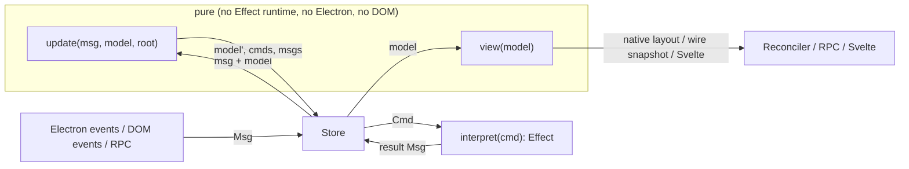

# Kvist architecture

This is the rulebook. If code does not fit one of these shapes, either the
shape is wrong or this file needs a deliberate change. Do not add a third
way.

Kvist runs on [Effect](https://effect.website) 4 and an Elm-style
architecture (TEA). Svelte is the view layer in the renderers.

## The loop



There is one loop per process: main, the chrome, the overlay, and each tab's
page preload.

## Five building blocks

1. **Model.** Immutable, serialisable data. It never holds an Electron
   object, a DOM node, a callback, a fiber or a promise. Those live in
   services, keyed by an id that the model holds (`TabId`, `PromptId`,
   `DownloadId`).
2. **Msg.** A fact that happened, named in the past tense with its source:
   `TabTitleChanged`, `KeyPressed`, `ConfigLoaded`, `ChromeRequestedTab`.
   Each feature declares its Msgs with `Schema.TaggedUnion`. One declaration
   gives constructors, `match`, guards and a wire codec. Every Msg has
   exactly one owning feature.
3. **update.** `(msg, model, root) → Next`. Pure and synchronous. `root` is
   the read-only whole tree, for reading other features' state. `Next`
   holds the new slice, `cmds` (work to do) and `msgs` (follow-ups for other
   features). Cross-feature reactions are always explicit follow-up Msgs.
   A feature never writes another feature's slice.
4. **Cmd.** An instruction, named in the imperative: `LoadUrl`,
   `FocusPage`, `RecordVisit`. Cmds are data (a `Schema.TaggedUnion` per
   feature), so update tests compare them with plain equality. A program may
   give a Cmd a key (`keyOf`). A new Cmd with the same key interrupts the
   running one. That replaces hand-written "latest request" counters.
5. **view.** A pure projection of the model.
   - Main has two views. **Native layout** says which tab views are visible
     and at what bounds; a reconciler applies the difference after every
     change. **Wire snapshots** are what each renderer is sent, streamed
     over RPC and deduplicated.
   - In a renderer, the view is Svelte.

> [!IMPORTANT]
> State the native layer should _be in_ is derived and reconciled. Things it
> should _do_ are Cmds. Visibility, bounds and z-order are derived.
> Navigate, focus, scroll, find and click are Cmds.

## Why `update` is not an `Effect`

`update` could be an Effect that reads and writes a `SubscriptionRef` and
calls services directly. We reject that for the state-transition step only.
`update` still uses Effect's pure modules: `Schema` constructors, `Match`,
`Option`, `Array`, `HashMap`, `Data`, `Equal`. It does not use the `Effect`
type, which means no fibers, services, clock or async.

| Concern                        | Pure `update`                              | `update` as an `Effect`                                                  |
| ------------------------------ | ------------------------------------------ | ------------------------------------------------------------------------ |
| Keys answered on the same tick | Guaranteed by the type                     | Needs `runSync`, which throws at runtime once anything inside goes async |
| One transition at a time       | Each Msg is handled whole                  | Any async step lets two Msgs interleave                                  |
| Tests                          | `expect(update(msg, model)).toEqual(next)` | Every test provides layers and runs the effect                           |
| What a change can do           | Return data                                | `R` grows one service at a time                                          |
| Replay                         | A Msg log replays to the same model        | Clock, randomness and database reads differ                              |

So **deciding** what happens next is `update`: pure, synchronous, total.
**Doing** it is `interpret`: an Effect, with services, errors, retries,
scopes and cancellation.

Consequences:

- Anything `update` would look up must already be in the model.
  Bookmarked URLs are loaded into the model and kept current by Msgs.
- Time arrives in the Msg (`KeyPressed { at }`), or a Cmd asks for it and
  returns it as a Msg.
- Ids are counters in the model (`nextPromptId`), not `Random`.

If a feature needs several async steps with state checks in between, give
it a long-running interpreter. `update` stays pure.

## Store and runtime

`src/shared/tea/` holds the kernel. It knows nothing about Electron or the
DOM.

- `dispatch(msg)` is **synchronous**. `before-input-event` must answer
  "consumed?" on the same tick, so the path from a key to the new model is
  plain code.
- Keys use a pure `resolveKey(model, input, source)`. The interceptor
  calls it, calls `preventDefault` if the key was consumed, then
  dispatches. `update` stays the only state writer.
- Dispatch is re-entrant. A Msg raised while another is being handled is
  queued and handled in order.
- Cmds start on the same tick, on fibers in the store's scope. Each one is
  wrapped so a failure is logged and never takes the loop down. Expected
  failures are typed errors that the interpreter turns into Msgs.

## Services and layers

- An external capability is a `Context.Service` class with a `static layer`:
  windows, tab views, the clipboard, the shell, session handlers, the ad
  blocker, SQL, repositories, config files, style files.
- Only interpreters (`*.effects.ts`) and other services yield services.
  Programs never do.
- `src/main/index.ts` is the composition root and nothing else.
- Import a layer, never a `makeX` constructor
  (`anti-slop-effect/no-service-constructor-imports`).

## Lifetimes

- Anything with a lifetime past its call is acquired with
  `Effect.acquireRelease` in a `Scope`. There are no hand-written `release`
  functions.
- Scopes nest: **app**, then **window**, then **tab** and **overlay**.
  Closing a tab's scope removes its listeners, its event stream, its RPC
  server and its pending-prompt waiters. A resource that retires normally
  and one whose watched object disappears first take the same path.
- Electron events become streams (`Stream.callback`) forked in the scope of
  the resource they watch.
- **Nothing may cancel a quit.** Electron drops an `app.quit()` that lands
  on the same tick as the `will-quit` that cancelled it. The app scope
  closes on `quit` with a synchronous run, so every finalizer that must run
  at quit is synchronous. The SQL client closes there.

## IPC

- One `RpcGroup` per surface: `ChromeRpcs`, `OverlayRpcs`, `PageRpcs`. Each
  webContents gets a `MessagePort` that serves only its own group. **The
  port is the capability**: a webContents can only call what its port
  serves, so there are no sender checks.
- Main → renderer is one streaming RPC per surface that returns full
  snapshots. Renderer → main is `dispatch(intent)`, where the intent is a
  Schema union of the Msgs that surface may send. Questions that need an
  answer are plain request/response RPCs.
- The chrome and overlay preloads only forward a port to their own
  document. The page preload never forwards its port to the main world. It
  uses the port inside the isolated world.
- Everything that crosses a boundary is decoded with Schema: IPC,
  `config.toml`, style files, SQL rows and JSON columns.

## Renderer (Svelte)

- Each renderer has its own root program. Main's snapshot arrives as a
  `MainChanged` Msg. Local UI state lives in the renderer model.
- One adapter holds the model in `$state.raw` and exposes `model` and
  `dispatch`. Updates keep structural sharing, so derived slices that did
  not change do not propagate.
- Components read `model`, call pure formatters, and `dispatch` Msgs. They
  never mutate and never call RPC.
- DOM effects (focus, select) are Cmds, interpreted by a `Dom` service.
  Measurement attachments dispatch Msgs.
- The styling rules in `AGENTS.md` are unchanged.

## File layout

```
src/shared/tea/              Program, Next, Store (kernel; no Electron or DOM)
src/shared/schema/           wire schemas: ids, snapshots, intents
src/shared/rpc/              RpcGroups and the MessagePort protocol (both ends)
src/main/index.ts            composition root only
src/main/app/                root program, root interpreter, views
src/main/features/<f>/
  <f>.program.ts             Model, Msg, Cmd, init, update   (pure)
  <f>.effects.ts             interpret(cmd), event streams   (Effect)
  <f>.program.test.ts        pure tests
src/main/services/<s>.ts     Context.Service + Layer around one capability
src/renderer/app/            root program, interpreter, store adapter
src/renderer/features/<f>/   same convention, plus Component.svelte and .css
src/overlay/, src/preload/page/   same convention, small
```

## Enforced, not advised

Lint rules in `vite.config.ts` enforce these:

| Glob                       | Rule                                                                            |
| -------------------------- | ------------------------------------------------------------------------------- |
| `**/*.program.ts`          | No `electron`, `node:*`, `svelte`, `effect/Effect`, `effect/Stream` or services |
| `src/**` except the kernel | No `setTimeout`, `setInterval` or `console`                                     |
| `src/**`                   | No `node:fs` or `node:fs/promises`; use `FileSystem`                            |
| `src/renderer/**/*.svelte` | No RPC imports; components dispatch                                             |
| `src/**`                   | All `anti-slop-effect/*` rules                                                  |

## Testing

- `*.program.test.ts` carries most of the coverage: given a model and a
  Msg, assert the model, `cmds` and `msgs`. No runtime, no fakes.
- `*.effects.test.ts` tests interpreters against test layers: in-memory
  SQLite, recorder fakes for Electron services, and `TestClock` for debounce
  and throttle. Use `@effect/vitest` `it.effect` and `layer(...)`.
- End to end: CDP plus the main-process inspector, as `AGENTS.md`
  describes.
- No module mocking. Layers make it unnecessary.

## Effect code style

- `Effect.gen(function* () { … })` for anything sequential. `pipe` for
  short combinator chains.
- Errors are `Schema.TaggedError` classes, handled with `catchTag`.
  Defects are bugs and are only logged.
- Branch on tagged values with `Match` or the union's own `match`. Build
  them with their constructors. Lint enforces both.
- `runFork`, `runSync` and `runPromise` appear only in the composition
  root, the store kernel, and Electron callbacks that must answer
  synchronously.
- Comments follow the 40-word budget and plain-language rules in
  `AGENTS.md`.
