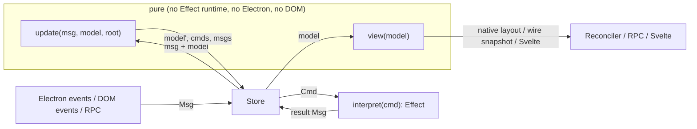

# Kvist on Effect: migration and architecture

## Context

Kvist is ~17k lines of TypeScript (≈9.4k non-test, 39 test files) across
Electron main, three preloads, a Svelte chrome and a Svelte overlay. The code
is disciplined but hand-rolled:

- Classes with private fields and observer `Set`s: `src/main/messages.ts`, `src/main/prompts.ts`, `src/main/bookmarks.ts:59`, `src/main/downloads.ts`.
- `acquire → release` disposers wired by hand in a 716-line composition root, `src/main/index.ts`.
- Debounce and throttle with raw `setTimeout`: `src/main/config.ts:86`, `src/main/user-style-files.ts:114`, `src/main/zoom.ts:110`, `src/main/downloads.ts:232`.
- Promise chains used as mutexes: `applying` in `src/main/index.ts:140`, `src/main/stylesheet.ts:32`.
- A hand-written typed IPC layer, `src/shared/ipc.ts` (528 lines), plus ad-hoc guards (`isPoint`, `isPromptAnswer` in `src/main/index.ts:200-214`).
- ArkType for validation, and a hand-written TOML decoder in `src/main/settings.ts`.
- State spread across mutable classes (`Vim`, `TabManager`, `Tab`) that call each other through callbacks.

The goal: Effect becomes the backbone, and an Elm-style architecture (TEA) is
the single, predictable shape for state and behaviour, in main and in the
renderer. Svelte stays as the view layer. There are no users, so we break
whatever we need to.

**Decisions so far:**

| Topic              | Decision                                                       |
| ------------------ | -------------------------------------------------------------- |
| Effect version     | 4.x (`effect@4.1.4`, pinned exactly)                           |
| Main process shape | Nested TEA programs composed into one model tree               |
| Renderer shape     | The same TEA shape; Svelte only reads the model and dispatches |
| IPC                | Effect RPC with Schema, over `MessagePort`                     |
| Persistence        | Drop Drizzle; use `effect/sql` with `@effect/sql-sqlite-node`  |

## Dependency audit

In Effect 4, platform, SQL, RPC, Schema, encoding and reactivity all ship
inside the single `effect` package. Several of those modules are marked
`@stability unstable`. That is acceptable here, and is why versions are pinned
exactly.

| Today                                     | Verdict | Replacement                                                                                                                                                                            |
| ----------------------------------------- | ------- | -------------------------------------------------------------------------------------------------------------------------------------------------------------------------------------- |
| `arktype`                                 | remove  | `effect/Schema`                                                                                                                                                                        |
| `drizzle-arktype`                         | remove  | Schema                                                                                                                                                                                 |
| `drizzle-orm`, `drizzle-kit`              | remove  | `effect/sql` (`SqlClient`, `SqlSchema`, `Migrator`) + `@effect/sql-sqlite-node`. It uses the same `node:sqlite` driver and enables WAL and `busy_timeout` itself                       |
| `smol-toml`                               | remove  | `effect/encoding` `Toml.parse` → `Result`. Spike result: it parses the config's tables and arrays-of-tables, and errors carry line and column (`Expected a value at line 1, column 5`) |
| `tldts-experimental`                      | keep    | Effect has no public-suffix parser. Wrap only where used (`src/main/adblock.ts:5`)                                                                                                     |
| `@ghostery/adblocker-electron`            | keep    | Wrap in an `Adblock` service                                                                                                                                                           |
| `node:fs`, `node:fs/promises`, `fs.watch` | remove  | `FileSystem` and `Path` via `@effect/platform-node` `NodeServices.layer`. `FileSystem.watch` gives a `Stream`                                                                          |
| `src/shared/ipc.ts`, `src/main/ipc.ts`    | remove  | `effect/rpc` `RpcGroup` + a small `MessagePort` protocol                                                                                                                               |
| Observer `Set`s, `Prompts` queue          | remove  | Model state in the TEA store. Continuations become `Deferred`s in a service                                                                                                            |
| `setTimeout` debounce and throttle        | remove  | `Stream.debounce`, `Stream.throttle`, `Schedule`                                                                                                                                       |
| Promise-chain mutexes                     | remove  | `Semaphore`, or keyed `FiberMap`                                                                                                                                                       |
| `console.*("kvist: …")`                   | remove  | `Effect.log*` and one `Logger` layer                                                                                                                                                   |
| `process.env.VITE_DEV_SERVER_URL`         | remove  | `Config`                                                                                                                                                                               |
| _new_ runtime                             | add     | `effect`, `@effect/platform-node`, `@effect/sql-sqlite-node`                                                                                                                           |
| _new_ dev                                 | add     | `@effect/vitest` (needs vitest 5, see Phase 0), `@effect/tsgo` (the language service for TypeScript 7)                                                                                 |

### Anti-slop lint plugin: refresh as part of this work

`tools/oxlint/anti-slop/` is a vendored copy of
[dmmulroy/anti-slop](https://github.com/dmmulroy/anti-slop). It was
installed by the `install-anti-slop` skill in `b38cf42`, and the skill was
removed again in `0b83c1c`. Since then upstream has moved from `6d53855`
(2026-08-18) to `13909c9` (2026-10-13).

**Base is recoverable.** `b38cf42` still holds the skill's pristine assets
(`.agents/skills/install-anti-slop/assets/anti-slop/`). So this is a real
three-way merge (base → local, base → upstream), not a guess.

**Local deviations to keep:**

| Local change                                                                                                             | Keep                                                                       |
| ------------------------------------------------------------------------------------------------------------------------ | -------------------------------------------------------------------------- |
| Imports `vite-plus/lint/plugins` instead of `@oxlint/plugins`, in every file                                             | yes. Vite+ owns the oxlint pair here                                       |
| `rules/no-verbose-comments.ts`, `shared/verbose-comments.ts`, `verbose-comment-baseline.ts` (the 40-word comment budget) | yes. Project-owned rule. It stays registered in the generic plugin, as now |

A spot check of `rules/no-object-parameters.ts` shows that the import path
is its only local change. The merge confirms this for every file.

**Upstream changes to adopt:**

| Upstream                                                                                           | What it is                                                                                                         | Severity here |
| -------------------------------------------------------------------------------------------------- | ------------------------------------------------------------------------------------------------------------------ | ------------- |
| Shared helpers `function-parameters.ts`, `type-alias-resolution.ts`, `scope.ts`, `array-method.ts` | Refactors and correctness fixes in existing rules (scoped and generic alias resolution, the known-value guard fix) | n/a           |
| `no-array-filter-map`                                                                              | One pass instead of `.filter().map()`                                                                              | error         |
| `no-reduce-accumulator-copy` + native `oxc/no-accumulating-spread`                                 | Stops quadratic reducers                                                                                           | error         |
| `require-readable-spacing` (vendored eslint-stylistic padding)                                     | Blank lines between statement groups. Autofixable                                                                  | error         |
| Effect `no-manual-tag-comparison`                                                                  | No `x._tag === "…"` and no `switch (x._tag)`. Use `Match` or the union's `match`                                   | error         |
| Effect `no-manual-tagged-construction`                                                             | No literal `{ _tag: "…" }`. Use `.make` or the case constructor                                                    | error         |
| Effect `no-manual-effect-error-tag`                                                                | No `_tag` branching in catch handlers. Use `catchTag(s)`                                                           | error         |
| Effect `prefer-effect-match`                                                                       | Chained literal ternaries become `Match`                                                                           | error         |
| Effect `no-service-constructor-imports` (already vendored, unused)                                 | Import the layer, not `makeX`                                                                                      | error         |

The four new Effect rules match the TEA conventions above. In practice,
`update` is written as `Msg.match(msg, { … })`, which is exhaustive and
never `switch (msg._tag)`. Msgs and Cmds are built with their case
constructors.

**The skill comes back too.** Re-add `install-anti-slop` to
`.agents/skills/` and `skills-lock.json`, pinned to `13909c9`. Its
`references/update.md` is the procedure for the next refresh. Record
provenance in a new `tools/oxlint/anti-slop/UPSTREAM.md`: the source commit,
the base commit, the local deviations above, and the verification run.

---

## Architecture

This section becomes `docs/architecture.md`, linked from `AGENTS.md`. It is
the rulebook: if code does not fit one of these shapes, the shape is wrong or
the rulebook needs a deliberate change.

### The loop



One loop per process: main, chrome, overlay, and each tab's page preload.

### Five building blocks

1. **Model**: immutable, serialisable data. Never an Electron object, DOM
   node, callback, fiber or promise. Those live in services, keyed by an id
   that the model holds (`TabId`, `PromptId`, `DownloadId`).
2. **Msg**: a fact that happened, named in past tense with its source:
   `TabTitleChanged`, `KeyPressed`, `ConfigLoaded`, `ChromeRequestedTab`,
   `SuggestionsReceived`. Each feature defines its Msgs with
   `Schema.TaggedUnion`, so the same declaration gives constructors,
   `match`, guards and a wire codec. Every Msg has exactly one owning feature.
3. **update**: `(msg, model, root) → Next`. Pure and synchronous. `root` is
   the read-only whole tree, for reading other features' state. `Next` holds
   the new slice, `cmds` (work to do) and `msgs` (follow-ups for other
   features). Cross-feature reactions are always explicit follow-up Msgs.
   Features never write each other's slices.
4. **Cmd**: an instruction, named imperatively: `LoadUrl`, `FocusPage`,
   `RecordVisit`, `ShowMessage`. Cmds are data (a `Schema.TaggedUnion` per
   feature), so update tests assert on them with plain equality. A Cmd may
   carry a `key`. A new Cmd with the same key interrupts the running one
   (`FiberMap`). This replaces every hand-written "latest token" counter
   (`src/renderer/lib/completion.svelte.ts:27`).
5. **view**: a pure projection of the model.
   - In main there are two views. **Native layout**: which tab views are
     visible, and at what bounds. A `ViewReconciler` service diffs and
     applies it after every change. **Wire snapshots**: `chromeView(model,
     windowId)`, streamed to each renderer over RPC and deduplicated with
     `Equal`.
   - In the renderer, the view is Svelte.

> [!IMPORTANT]
> **State the native layer should _be in_ is derived and reconciled.
> Things it should _do_ are Cmds.** Visibility, bounds and z-order are
> derived. Navigate, focus, scroll, find and click are Cmds. This removes the
> class of bug where a forgotten `setVisible` call leaves views out of sync.

### Why `update` is not an `Effect`

`update` could be an Effect. It is possible to write
`update: (msg) => Effect<void, never, Store | Services>`, where it reads and
writes a `SubscriptionRef` and calls services directly. This is the
"Effect-native actor" shape. We reject it for the state-transition step
only. Effect still does everything around it.

The question is not "Effect or not". It is "which part of Effect". `update`
uses Effect's pure modules: `Schema` constructors, `Match`, `Option`,
`Array`, `HashMap`, `Data`, `Equal`. What it does not use is the `Effect`
type, that is, the runtime: fibers, services, the clock, async.

| Concern                        | `update` as a pure function                                        | `update` as an `Effect`                                                                                                                                                                      |
| ------------------------------ | ------------------------------------------------------------------ | -------------------------------------------------------------------------------------------------------------------------------------------------------------------------------------------- |
| Keys answered on the same tick | Guaranteed by the type. A function cannot go async.                | Needs `runSync`. That only works if nothing inside ever goes async. The type does not say so. One later `yield*` of an async service throws `AsyncFiberException` on a keypress, at runtime. |
| One transition at a time       | Each Msg is handled whole before the next one starts.              | Any async step lets two Msgs interleave. We are back to today's races (`applying` in `src/main/index.ts:140`).                                                                               |
| Tests                          | `expect(update(msg, model)).toEqual(next)`. No layers, no runtime. | Every test provides layers, runs the effect, and inspects recorded calls.                                                                                                                    |
| What a change can do           | The signature is all it can do: return data.                       | `R` grows one service at a time. Logic and side effects merge again, which is today's shape with different syntax.                                                                           |
| Replay and debugging           | A log of Msgs replays to the same model. Time travel is a fold.    | Reads of the clock, randomness or the database make a replay differ.                                                                                                                         |
| Cost per event                 | One function call.                                                 | A fiber per keystroke and per Electron event. Small, but it is on the hottest path.                                                                                                          |

The actor shape is also already available where it fits. An interpreter is
exactly an Effect that receives a Cmd and may run for a long time, hold
resources, and report back with Msgs. So the split is:

- **Deciding** what happens next is `update`: pure, synchronous, total.
- **Doing** it is `interpret`: an Effect, with services, errors, retries,
  scopes and cancellation.

Some consequences for `update`:

- Anything it would "look up" must already be in the model. Bookmarked
  URLs are loaded into the model at start and kept current by Msgs. They are
  not a `has(url)` call.
- Time arrives in the Msg. The source stamps it (`KeyPressed { at }`,
  `ConfigLoaded { at }`), or a Cmd asks for it and returns it as a Msg.
- Ids are counters in the model (`nextPromptId`), not `Random`.

**What would change this decision:** if one feature needs to sequence
several async steps with state checks in between, and that flow does not
fit as one Cmd with result Msgs. Even then, the fix is a long-running
interpreter for that feature. `update` stays pure.

### Store and runtime

`src/shared/tea/` holds the process-agnostic kernel: the `Program`, `Next` and
`Store` types, plus `Store.make(program, interpret)`.

- `dispatch(msg)` is **synchronous**. This is a hard constraint:
  `before-input-event` must answer "consumed?" on the same tick
  (`src/main/keys.ts`). The sync path is plain code: pure `update`, a
  mutable cell, `Queue.offerUnsafe` for Cmds, `PubSub.publishUnsafe` for
  changes.
- Key handling uses a pure `resolveKey(model, input, source) → Consumed(msgs) | PassThrough`.
  The interceptor calls it, calls `preventDefault` if consumed, then
  dispatches. `update` stays the only state writer.
- Dispatch is re-entrant safe. A Msg raised while another is being handled
  (an Electron event fired synchronously by a Cmd) is queued and drained in
  order (a trampoline).
- Cmds run on fibers in the store's scope. Every Cmd is wrapped in
  `catchCause` → log. A failing Cmd never takes the loop down. Expected
  failures are typed errors that the interpreter maps to Msgs
  (`NavigationFailed`, `MessageShown(error)`).

### Services and layers

- An external capability is a `Context.Service` class with a `static layer`.
  Examples: Electron windows, tab views, `Clipboard`, `Shell`, the session
  handlers, `Adblock`, `SqlClient`, repositories, config files, style files.
- Only interpreters (`*.effects.ts`) and other services yield services.
  Programs never do.
- `src/main/index.ts` becomes the composition root and nothing else. It
  builds the layer graph, starts the root program, and wires app lifecycle.
- Enable `anti-slop-effect/no-service-constructor-imports`: import the
  layer, not `makeX`.

### Lifetimes

This replaces `AGENTS.md` "Resource lifetimes".

- Anything with a lifetime past its call is acquired with
  `Effect.acquireRelease` in a `Scope`. There are no hand-written `release`
  functions.
- Scopes nest: **app** (the runtime), then **window**, then **tab**, and
  **overlay**. Closing a tab's scope removes its listeners, its event
  stream, its RPC client and its pending-prompt waiters. This answers both
  questions `AGENTS.md` asks today: the normal-retire path and the
  watched-thing-disappears path become the same path.
- Electron events become streams (`Stream.callback`) forked in the scope of
  the resource they watch.
- **Nothing may cancel a quit.** That rule stays. The root scope closes on
  `quit` with `runSync`. Every finalizer that must run at quit is therefore
  synchronous (`Effect.sync`). The SQL client closes there, as `Database`
  does today.

### IPC

- One `RpcGroup` per surface: `ChromeRpcs`, `OverlayRpcs`, `PageRpcs`. A
  surface gets a `MessagePort` that serves only its own group. **The port is
  the capability.** That replaces the sender checks (`TabManager.ownsTab`,
  `completion.owns`), because a webContents can only call what its port
  serves.
- Main → renderer is one streaming RPC per surface: `subscribe()` returns a
  `Stream` of full snapshots. That is today's full-snapshot rule, kept.
- Renderer → main is `dispatch(intent)`. The intent is a Schema union of the
  main Msgs that surface may send. Requests that need an answer
  (`omniboxSuggestions`, `commandCompletions`) are plain request/response
  RPCs.
- The chrome and overlay preloads only forward a port to their own
  document. **The page preload never forwards its port to the main world.**
  The page's own scripts must not reach it. It uses the port inside the
  isolated world.
- Everything that crosses a boundary is decoded with Schema. That covers
  IPC, `config.toml`, user style files, SQL rows and `JSON` columns.

### Renderer (Svelte)

- Each renderer has its own root program. Main's snapshot arrives as a
  `MainChanged` Msg. Local UI state lives in the renderer model: omnibox
  text, the completion list and its selection, the downloads panel pin and
  its timer, the find input.
- One adapter, `src/renderer/app/store.svelte.ts`, holds the model in
  `$state.raw` and exposes `model` and `dispatch`. Updates keep structural
  sharing, so `$derived` slices that did not change do not propagate. That
  also removes the "`$state` proxy cannot cross IPC" footgun by
  construction.
- Components only read `model`, call pure formatters (like
  `describePrompt`), and `dispatch` Msgs. They never mutate and never call
  RPC.
- DOM effects (focus, select) are Cmds. A `Dom` service interprets them.
  Components register elements with `{@attach dom.register("omnibox")}`.
  Measurement attachments (`contentRect`, `anchor`) dispatch Msgs.
- The styling rules in `AGENTS.md` are unchanged.

### File layout

```
src/shared/tea/              Program, Next, Store (kernel; no Electron or DOM)
src/shared/schema/           wire schemas: ids, snapshots, intents
src/shared/rpc/              RpcGroups and the MessagePort protocol (both ends)
src/main/index.ts            composition root only
src/main/app/                root program, root interpreter, views (chromeView, layout)
src/main/features/<f>/
  <f>.program.ts             Model, Msg, Cmd, init, update   (pure)
  <f>.effects.ts             interpret(cmd), event streams   (Effect)
  <f>.program.test.ts        pure tests
src/main/services/<s>.ts     Context.Service + Layer around one capability
src/renderer/app/            root program, interpreter, store.svelte.ts
src/renderer/features/<f>/   same convention, plus Component.svelte and .css
src/overlay/, src/preload/page/   same convention, small
```

Main features: `vim`, `tabs`, `prompts` (session restore, permissions,
external protocols), `messages`, `downloads`, `completion`, `config`,
`styles`, `history`, `bookmarks`, `zoom`, `session`.

### Enforced, not advised

oxlint rules with per-glob overrides in `vite.config.ts`:

| Glob                       | Rule                                                                                                                                                                                                                           |
| -------------------------- | ------------------------------------------------------------------------------------------------------------------------------------------------------------------------------------------------------------------------------ |
| `**/*.program.ts`          | `no-restricted-imports`: `electron`, `node:*`, `svelte`, `effect/Effect`, `effect/Stream`, `**/services/**`. Allowed: `effect/Schema`, `effect/Data`, `effect/Match`, `effect/Option`, `effect/Array` and similar pure modules |
| `src/**` except the kernel | `no-restricted-globals`: `setTimeout`, `setInterval`, `console`                                                                                                                                                                |
| `src/**`                   | `no-restricted-imports`: `node:fs`, `node:fs/promises` (use `FileSystem`)                                                                                                                                                      |
| `src/renderer/**/*.svelte` | `no-restricted-imports`: `**/rpc/**` (components dispatch; they never call RPC)                                                                                                                                                |
| `src/**`                   | all `anti-slop-effect/*` rules (see the anti-slop refresh above)                                                                                                                                                               |
| `src/shared/rpc/**`        | replaces today's `src/shared/ipc.ts` override: `no-unknown-parameters` and `no-unknown-returns` off, because the transport is where payloads are `unknown` until decoded                                                       |

### Testing

- `*.program.test.ts`: the bulk of coverage. Given a model and a Msg,
  assert the model, `cmds` and `msgs`. No runtime, no fakes.
- `*.effects.test.ts`: interpreters against test layers. Use in-memory
  SQLite (`SqliteClient.layer({ filename: ":memory:" })`), recorder fakes
  for Electron services (a `Ref` of calls), and `TestClock` for debounce
  and throttle. `@effect/vitest` `it.effect` / `layer(...)`.
- End to end: CDP plus the main-process inspector, as `AGENTS.md` describes now.
- `no-module-mocking` stays. Layers make it unnecessary.

### Effect code style

- `Effect.gen(function* () { … })` for anything sequential. `pipe` for
  short combinator chains.
- Errors: `Schema.TaggedError` classes, handled with `catchTag(s)`.
  Defects are bugs and only get logged.
- Branch on tagged values with `Match` or the union's own `match`. Build
  them with their constructors. Lint enforces both (`anti-slop-effect`).
- Never `runPromise` or `runSync` outside the composition root, the store
  kernel, and Electron callbacks that must answer synchronously.
- Comments: the existing 40-word budget and plain-language rules apply.

---

## Migration phases

Each phase is one PR (or a few), leaves the app working, and passes
`pnpm check` and `pnpm test`.

### Phase 0: tooling

- [x] Bump `vite-plus` and the `vite` catalog to 1.x (bundles vitest 5.1, which `@effect/vitest` 4.x needs). Fall back to a small local `it.effect` helper over `effect/testing` `TestClock` if the bump breaks the build.
- [x] Add `effect`, `@effect/platform-node`, `@effect/sql-sqlite-node` (exact pins), `@effect/vitest`, `@effect/tsgo`.
- [ ] `vite.config.ts`: externalize `effect` and `@effect/*` as one unit in the main build. A bundled copy plus an externalized `@effect/sql-sqlite-node` would be two `Context` instances, and services would not be found. That is the same lesson as the ArkType comment. Preloads and renderers bundle everything.
- [ ] **Refresh anti-slop** (its own PR, before any Effect code lands):
  - Re-add the `install-anti-slop` skill, pinned to upstream `13909c9`, with a `skills-lock.json` entry.
  - Follow its `references/update.md`. Back up `tools/oxlint/anti-slop/` first. Stage incoming with `install.mjs` into a temp dir. Extract the base from `b38cf42`. Merge three-way, keeping the local deviations.
  - Register the new generic rules and `oxc/no-accumulating-spread`. Register the `anti-slop-effect` plugin with all five rules. All at `error`.
  - Check that the Vite+ oxlint version supports the incoming plugin API. Bump it with the Vite+ 1.x step if needed.
  - Run `require-readable-spacing --fix` as a separate whitespace-only commit. Format again and confirm that a second pass changes nothing.
  - Fix new findings in the current code. Most are short-lived, but the rules must be green before the migration starts.
  - Write `tools/oxlint/anti-slop/UPSTREAM.md`. Run the upstream rule tests against the merged copy, adapted to `vite-plus/lint/plugins`, to cover the changed rules.
- [ ] Write `docs/architecture.md` (the Architecture section above). Replace "Resource lifetimes", "Persistence" and the IPC bullets in `AGENTS.md`, and point to it.

### Phase 1: kernel and leaf services (main still imperative)

- [ ] `src/shared/tea/`: `Program`, `Next`, `Store` with sync dispatch, trampoline, keyed Cmds. Full unit tests.
- [ ] `ManagedRuntime` in `src/main/index.ts` with `NodeServices.layer` and a `Logger` layer. Spike: the root scope closes synchronously on `quit`.
- [ ] Schema replaces ArkType: `src/main/db/validation.ts` becomes a thin `SchemaIssue → Problem` adapter. Callers: `history.ts`, `bookmarks.ts`, `session.ts`, `index.ts`.
- [ ] Config as a service: `src/main/config.ts` + `src/main/settings.ts` become `ConfigFiles` (`FileSystem.watch` → `Stream.debounce(50 millis)` → `Toml.parse` → Schema decode with per-field fallback). The "keep last good settings on a syntax error" rule moves into the stream (`Stream.scan`).
- [ ] Style files: `src/main/user-style-files.ts` gets the same treatment.
- [ ] SQL: `src/main/db/database.ts` → `SqliteClient.layer` + `Migrator` with migrations as TS modules (`import.meta.glob`). That deletes the `kvist-db-migrations` Vite plugin, the `asarUnpack` entry and the `existsSync`/asar workaround. Start fresh: use a new DB file (`kvist.sqlite`) and delete the old `kvist.db` (and its `-wal`/`-shm` files) on first launch. Drop `src/main/db/migrations/` and `drizzle.config.ts`. Repositories: `HistoryRepo`, `BookmarksRepo`, `SessionRepo` with `SqlSchema` + Schema rows. Keep `escapeLike` and `clampLimit` from `src/main/db/query.ts`.
- [ ] Zoom: move from `zoom.json` to a `zoom` table (`origin` primary key, `level`), behind a `ZoomRepo`. Ignore any existing `zoom.json`. That deletes the debounce, the atomic-rename write and `flushOnQuit` in `src/main/zoom.ts`.
- [ ] Remove `arktype`, `drizzle-*`, `smol-toml`.

### Phase 2: RPC transport

- [ ] `src/shared/rpc/`: a `MessagePort` protocol for `RpcServer.Protocol.make` (main, `MessagePortMain`) and `RpcClient.Protocol.make` (DOM `MessagePort`). One client id per port. Port close → disconnect → the stream ends.
- [ ] `ChromeRpcs`, `OverlayRpcs`, `PageRpcs` with Schema payloads. They port every channel in `src/shared/ipc.ts`, `fromPage`/`toPage`, `fromOverlay`/`toOverlay` and `toMainQueries`.
- [ ] Preloads become port forwarders (`src/preload/index.ts`, `overlay.ts`). `page.ts` keeps its port in the isolated world.
- [ ] Delete `src/shared/ipc.ts`, `src/main/ipc.ts`, `isPoint`, `isPromptAnswer`, and their lint overrides.
- [ ] At this point the renderer still uses runes stores, fed by RPC streams.

### Phase 3: main on TEA, feature by feature

Order chosen so each step has few dependents:

- [ ] `messages` (`src/main/messages.ts`)
- [ ] `prompts` with permissions, external protocols and session restore (`prompts.ts`, `permissions.ts`, `external.ts`, the restore flow in `src/main/index.ts:492-530`). Electron `callback(allow)` continuations become `Deferred`s in a `PendingAnswers` service, released by the prompt's tab scope.
- [ ] `vim` (`vim.ts`, `keys.ts`, `keybinds.ts`, `commands.ts`, `actions.ts`). `resolveKey` is pure. `actions.ts` dissolves into Cmds.
- [ ] `downloads` (`downloads.ts`, `download-rate.ts`, `downloads-path.ts`). The throttle becomes `Stream.throttle`.
- [ ] `tabs` (`tab-manager.ts`, `tab.ts`, `view-stack.ts`, `page-host.ts`, `error-page.ts`, `context-menu.ts`). The `ViewReconciler` owns z-order and bounds, which replaces the `ViewStack` invariant. Per-tab scope plus an event stream.
- [ ] `completion` overlay (`completion-overlay.ts`, `completion-bounds.ts`, `overlay-host.ts`)
- [ ] `config` / `styles` / `adblock` / `local-pages` apply, as one serialized interpreter. That replaces the `applying` promise chain.
- [ ] `history`, `bookmarks`, `zoom`, `session` persistence Cmds
- [ ] `src/main/index.ts` reduced to the composition root

### Phase 4: renderers on TEA

- [ ] Chrome: `src/renderer/lib/*.svelte.ts` → `src/renderer/features/*` programs. Components move to `model` + `dispatch`. Use the Svelte MCP autofixer on every touched component.
- [ ] Overlay: `src/overlay/`
- [ ] Page preload: `src/preload/page.ts`, `hints.ts`, `menu.ts` get the full loop, like everywhere else. Hint mode (labels, typed prefix) and the context menu become the page program's model. DOM rendering of hint labels stays inline-styled, as now.

### Phase 5: enforcement and cleanup

- [ ] Add the restricted-import and restricted-global lint rules from the table above. Fix what they find.
- [ ] Prune `tools/oxlint/anti-slop/verbose-comment-baseline.ts` entries for deleted files.
- [ ] Final `AGENTS.md` pass. Remove gotchas that no longer apply (the `$state` proxy, `contextBridge` patching, the ArkType module-instance comment).

## Reuse

Keep these pure helpers, moved into programs or views:

- `src/main/completion-bounds.ts`: whole-pixel containment maths
- `src/main/download-rate.ts`, `src/shared/progress.ts`, `src/shared/bytes.ts`
- `src/shared/url.ts` (`resolveUrl`, `originOf`), `src/main/external.ts:33-60` (`externalProtocolTarget`, `looksLikeHostPort`)
- `src/main/omnibox.ts` merge logic, `src/main/commands.ts` `COMMANDS` table and `completeCommand`
- `src/main/user-css.ts` parser, `src/main/stylesheet.ts` composition
- `src/main/db/query.ts` (`escapeLike`, `clampLimit`)
- `src/renderer/lib/prompts.svelte.ts` `describePrompt` / `buttonLabels`
- Existing test cases: rewrite them as program tests. They are the behaviour spec.

## Verification

- Per phase: `pnpm check` (fmt, lint, type-check) and `pnpm test` are green.
- Phase 0, anti-slop: the adopted upstream rule tests pass against the merged copy. A scratch file with `switch (x._tag)`, a literal `{ _tag: "A" }`, `.filter().map()` and a spreading reducer is rejected. `no-verbose-comments` still fires on a 41-word comment. The `UPSTREAM.md` diff against `b38cf42` lists only the recorded deviations.
- Phase 1: a config typo shows the line and column in the echo area, and the last good settings stay. Editing a style file restyles open tabs. History, bookmarks and session restore survive a relaunch.
- Phase 2: all chrome actions work over RPC. In devtools, a page document cannot reach any port (`window` has no kvist handle). Closing a tab ends its RPC stream (log line from the finalizer).
- Phase 3–4: drive keys through the main-process inspector (`sendInputEvent`, all keys in one `Runtime.evaluate`), per `AGENTS.md`. Check j/k scrolling, `f` hints, `:` commands with completion, `/` find, the y/n prompt mode, the omnibox dropdown placement, and HTML fullscreen with Escape.
- Quit: `Cmd-Q` with a pending zoom change and open tabs. The app exits fully (no dock zombie), and the next launch restores the session and zoom.

## Settled questions

Tracking: this plan file only, no Linear issues. Phase checkboxes here are the record.

:::question
What should happen to your existing `kvist.db` (history, bookmarks, saved session)?

The Effect migrator keeps its own bookkeeping table, so the Drizzle-made DB cannot just carry on. A one-time import costs one throwaway migration. Starting fresh costs your browsing history.

- [x] Start fresh: new DB file, delete the old one
- [ ] One-time import from the old DB on first launch

Recommended: Start fresh. There are no other users, and it keeps the first migration clean.
:::

:::question
Move per-origin zoom from `zoom.json` into SQLite?

SQLite writes are synchronous and cheap. Moving zoom there deletes the debounce, the atomic rename and the quit-time flush in `src/main/zoom.ts`. The cost is that zoom is no longer a hand-editable file.

- [x] Yes, move it to a table
- [ ] No, keep `zoom.json` (port it to `FileSystem`)

Recommended: Yes.
:::

:::question
Should the page preload (runs inside every tab) also get the full TEA loop?

It is small: hints, the context menu, editable detection and scrolling. Hint mode is a real state machine, so TEA fits it. The cost is an Effect runtime bundled into every tab's preload (tens of KB, loaded from disk).

- [x] Yes, same shape everywhere
- [ ] No, plain functions over the RPC client only

Recommended: Yes. "One shape everywhere" is the point of the guidelines.
:::

:::question
Track this in Linear?

- [ ] Yes: one "Effect" milestone, one issue per phase, sub-issues per feature in Phase 3
- [x] No, this plan file is enough

Recommended: Yes, per the Tracking section of `AGENTS.md`.
:::
